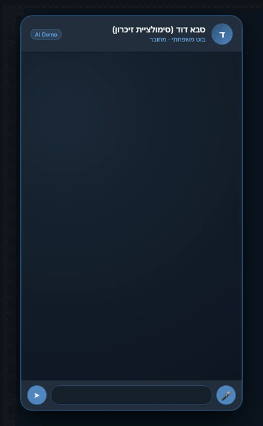
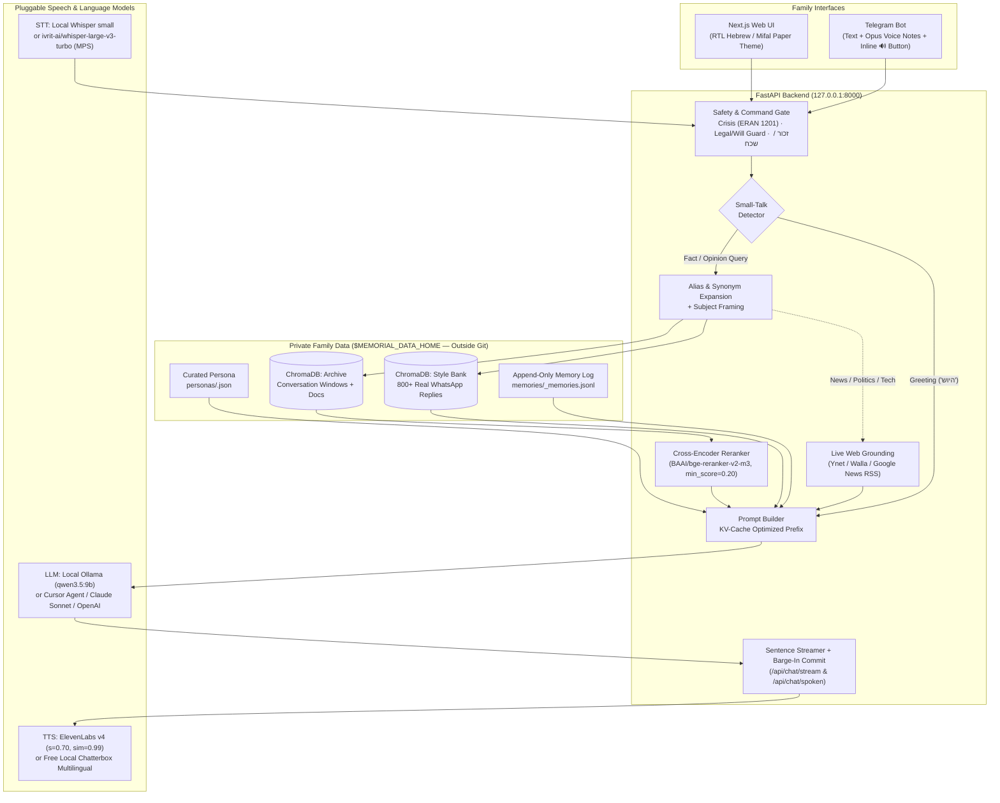
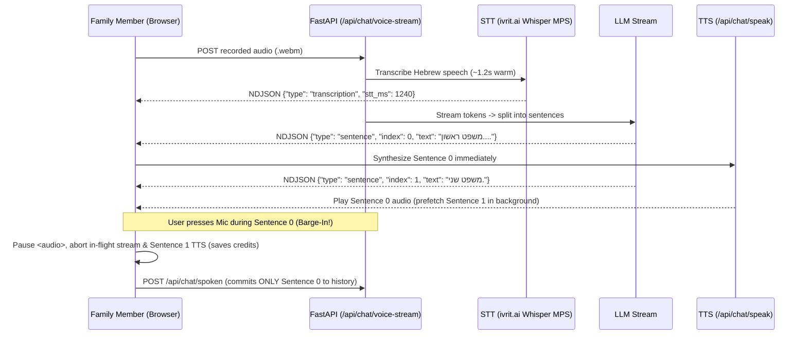

<div align="center">

# Living Memory (`memorial-ai-framework`)

**An open-source, privacy-first AI framework for preserving the voice, writing style, stories, and wisdom of a loved one.**

[](LICENSE)
[](apps/api/pyproject.toml)
[](apps/api/app/main.py)
[](apps/web/package.json)
[](apps/api/tests)
[](apps/api/app/services/telegram_bot.py)

[**Why This Exists**](#why-standard-rag-fails-for-memorials) · [**Architecture**](#architecture) · [**Quick Start**](#quick-start-5-minutes) · [**Concrete Examples**](#concrete-examples) · [**Voice & Barge-In**](#voice-pipeline--barge-in-history) · [**Telegram Bot**](#telegram-bot-integration) · [**Evaluation & Golden Set**](#evaluation-harness--golden-set) · [**Ethics & Safety**](#ethical--safety-guardrails)

<br/>



*100% synthetic demo persona ("סבא דוד") — showing `/start` AI disclosure, sharp WhatsApp-style replies, the inline `🔊 השמע בקול` button, and bidirectional voice notes ([Download MP4](docs/assets/telegram-demo.mp4)).*

</div>

---

## Why Standard RAG Fails for Memorials

Most people who try to build a memorial chatbot dump a WhatsApp export into a generic "Chat with PDF" tool — and get something that sounds like a corporate helpdesk reciting random sentences out of context.

Standard RAG fails on family archives for **five specific reasons**, each solved in this framework:

| Failure Mode in Standard RAG | How `memorial-ai-framework` Solves It |
| :--- | :--- |
| **1. Fixed 500-word chunks mash 40 WhatsApp messages & 6 speakers into one line** | **Conversation-Window Chunking (`extract_conversation_windows`):** Parses `_chat.txt` timestamps, merges consecutive bursts sent within 3 minutes by the loved one, and pairs them with the 2 preceding family messages they were replying to. |
| **2. The bot knows *facts* about the person, but sounds like a generic AI assistant** | **Dual-Collection Retrieval (Archive + Style Bank):** Alongside factual memories, every turn retrieves the loved one's real short WhatsApp exchanges (`prompt → reply`) so the LLM matches their exact sentence length, cadence, punctuation (`....`), and dry humor. |
| **3. Second-person questions (`"איפה גדלת?"`) score ~0.01 against third-person archives (`"דוד גדל ב..."`)** | **Subject-Aware Query Rewriting & Alias Expansion (`retrieve_context`):** Expands family nicknames (`"אמא" → "רחל"`, `"אוטו" → "רכב"`) and re-scores candidates with `BAAI/bge-reranker-v2-m3` framed around the person (`"{query} (על {subject})"`). |
| **4. Saying `"היי"` or `"מה נשמע?"` pulls random archive chunks that the bot retells as today's news** | **Small-Talk Gate & Reranker Score Cutoff (`rerank_min_score=0.20`):** Greetings bypass factual retrieval completely; weak archive matches are dropped instead of polluting the prompt. |
| **5. Interrupting a voice reply leaves unspoken sentences in chat history** | **Sentence-Level Streaming + Spoken-Only History Commit (`commit_spoken_reply`):** Streams sentences one by one; if the user interrupts (barge-in), playback stops immediately and **only the sentences actually heard** are saved to session memory. |

---

## Architecture



---

## Quick Start (5 Minutes)

### 1. Create Your Private Data Folder (Outside Git)
All family files, WhatsApp exports, voice samples, Chroma vectors, and `.env` secrets live in `~/MemorialData` (`$MEMORIAL_DATA_HOME`), never inside the Git repository:

```bash
mkdir -p ~/MemorialData && chmod 700 ~/MemorialData
cp .env.example ~/MemorialData/.env && chmod 600 ~/MemorialData/.env
```

### 2. Start the API and Web App
```bash
# Terminal 1 — FastAPI Backend (http://127.0.0.1:8000)
cd apps/api
python3 -m venv .venv
./.venv/bin/pip install -r requirements.txt
./.venv/bin/uvicorn app.main:app --host 127.0.0.1 --port 8000

# Terminal 2 — Next.js Web UI (http://127.0.0.1:3000)
cd apps/web
npm install
npm run dev
```

### 3. Onboard a Loved One in `/admin` (No Manual JSON Required)
1. Open **http://127.0.0.1:3000/admin**.
2. **Create Person:** Enter their display name (e.g. `סבא דוד`) and upload a portrait photo.
3. **Import WhatsApp (`_chat.txt`):**
   - Select any exported WhatsApp group or private chat `.txt` file.
   - The admin UI automatically scans the file and lists every participant with their message count (`דוד כהן (1,187 הודעות)`).
   - Select your loved one from the dropdown and click **בנה סגנון ושיחות** — this builds both the **Style Bank** and the **Multi-Turn Conversation Windows**.
4. **Generate & Activate Persona:** Click **צור והפעל פרופיל אישיות** to analyze their writing style and activate `<person_id>.json` in one click.

---

## Concrete Examples

### Example 1: How WhatsApp `_chat.txt` Is Transformed Into RAG + Style Bank

**Raw WhatsApp export (`_chat.txt`):**
```text
[05.08.23, 23:57:10] נועה: אבא איפה אתם? הגעתם למלון?
[06.08.23, 00:16:13] דוד כהן: נועה אל תתחכמי, בשביל זה המציאו את המנגל....
[06.08.23, 00:17:02] דוד כהן: הנשר נחת במלון, הכל בסדר 👍
[06.08.23, 00:17:15] דוד כהן: ‎<attached: 0001-PHOTO.jpg>
```

**What `build_style_bank` indexes into the `style` collection:**
```json
{
  "prompt": "אבא איפה אתם? הגעתם למלון?",
  "reply": "נועה אל תתחכמי, בשביל זה המציאו את המנגל....",
  "embedding_input": "אבא איפה אתם? הגעתם למלון?\nנועה אל תתחכמי, בשביל זה המציאו את המנגל...."
}
```

**What `extract_conversation_windows` indexes into the `archive` collection (bursts within 3 min merged, media noise stripped):**
```text
[שיחת וואטסאפ משפחתית (2023-08-06)]
נועה: אבא איפה אתם? הגעתם למלון?
דוד כהן: נועה אל תתחכמי, בשביל זה המציאו את המנגל....
דוד כהן: הנשר נחת במלון, הכל בסדר 👍
```

---

### Example 2: Curated `persona.json` Structure

You can let `/admin` generate `<person_id>.json` automatically or refine it by hand (see full template in [`examples/persona.example.json`](examples/persona.example.json)):

```json
{
  "display_name": "סבא דוד",
  "overall_impression": "אב משפחה חם, ישיר, מהנדס פרקטי עם הומור יבש ועוקצנות אוהבת.",
  "family_context": {
    "wife": "רחל",
    "children": ["יונתן — הבכור", "נועה — בת"],
    "grandchildren": ["מאיה", "אורי"],
    "home": "מודיעין-מכבים-רעות"
  },
  "topics_of_knowledge": [
    "רכב — דיאגנוסטיקה, תיקונים, העדפה לתוצרת גרמנית",
    "אבטחת מידע, מחשבים, חומרה ופישינג",
    "אקטואליה, פוליטיקה וביטחון"
  ],
  "bot_voice": {
    "rules": [
      "תשובה קצרה. שורה או שתיים.",
      "בלי רשימות עם מקפים או מספרים. לעולם.",
      "נקודות ריבוי..... במקום סימני קריאה."
    ],
    "signature_lines": [
      "יפה מאוד, בשעה טובה",
      "הנשר נחת....",
      "אל תתחכמי",
      "הכי טוב להיות ביחד"
    ],
    "example_exchanges": [
      ["אבא, מתי אתה מגיע אלינו?", "תלוי מתי תזמינו.... הכי טוב להיות ביחד"],
      ["הילד לא מצליח להתחבר לוויפי", "מחברים לכבל ולא וויפי. או עושים ריסטרט."]
    ]
  },
  "retrieval_aliases": {
    "אמא": "רחל",
    "סבתא": "רחל"
  }
}
```

---

### Example 3: Before vs. After (Standard RAG vs. `memorial-ai-framework`)

| User Message | Naive RAG (Before) | `memorial-ai-framework` (After) |
| :--- | :--- | :--- |
| **`היוש`** | *"יפה, יושבים.... הכנתי קומפוט עם רימון וקצת פלפל שחור לראשית הדרך 🥰👍"* *(hallucinated from an unrelated chunk with 0.01 score)* | **`היוש.... מה נשמע אצלך?`** *(Small-talk gate skips archive lookup; answers in 1 short line)* |
| **`מה אתה חושב על האוטו שלך?`** | *"לא זוכר מספיק כדי לענות בוודאות..."* *(missed because archive says `רכב`, not `אוטו`)* | **`גרמני, כמובן.... ומי שמטפל בו כמו שצריך, הוא לא מאכזב. למה, אתה מתכנן להתחכם?`** |
| **`יש לי רעידות בהגה ב-100 קמ"ש, מה לבדוק קודם?`** | Generic 6-bullet ChatGPT essay | **`איזון גלגלים קודם.... 90% מהמקרים זה זה. אם לא עוזר, תבדוק צמיגים וחיבורי הגה, ותנסה לא להתחכם עם הפתרונות 😜`** |
| **`איך קראו למורה שלך לכיתה א'?`** | Invents a fictional teacher's name | **`לא זוכר.... זה היה לפני יותר מ-60 שנה, נו באמת 😜`** *(Honesty guard preserves trust)* |

---

### Example 4: API Walkthrough (`curl`)

```bash
# 1. Detect all senders in a WhatsApp _chat.txt export
curl -X POST http://127.0.0.1:8000/api/ingest/whatsapp-senders \
  -H "X-Access-Key: $ADMIN_KEY" \
  -F "file=@_chat.txt"
# -> [{"sender": "דוד כהן", "messages": 1187}, {"sender": "נועה", "messages": 412}]

# 2. Ingest WhatsApp style bank + multi-turn conversation windows for that sender
curl -X POST http://127.0.0.1:8000/api/ingest/whatsapp \
  -H "X-Access-Key: $ADMIN_KEY" \
  -F "person_id=11111111-2222-3333-4444-555555555555" \
  -F "sender=דוד כהן" \
  -F "file=@_chat.txt"
# -> {"status": "ok", "sender": "דוד כהן", "style_examples": 884, "conversation_windows": 509}

# 3. Stream a reply sentence-by-sentence (NDJSON) with deferred history commit
curl -N -X POST http://127.0.0.1:8000/api/chat/stream \
  -H "Content-Type: application/json" \
  -H "X-Access-Key: $FAMILY_KEY" \
  -d '{"person_id": "11111111-2222-3333-4444-555555555555", "message": "מה נשמע?", "defer_history": true}'
# -> {"type": "meta", "session_id": "...", "rag_ms": 12.4, ...}
# -> {"type": "sentence", "index": 0, "text": "בסדר גמור....", "llm_ms": 410.2}
# -> {"type": "sentence", "index": 1, "text": "מה איתך היום?", "llm_ms": 690.5}
# -> {"type": "done", "session_id": "...", "sentence_count": 2, ...}

# 4. Teach or remove a family fact directly from chat
#    "זכור: לנועה יש שתי חתולות"  -> saved to memories log + vector store + injected into every prompt
#    "שכח חתולות"                 -> marks fact forgotten and deletes its vector
```

---

## Voice Pipeline & Barge-In History



- **Zero wasted TTS credits on interruption:** Unspoken sentences are aborted before hitting ElevenLabs.
- **End-to-End Latency Telemetry:** Every turn displays `השהיה לקול: X.Xs (תמלול · חיפוש · משפט ראשון · קול)` and logs privacy-safe timing numbers (never text) to `$MEMORIAL_DATA_HOME/eval/latency.jsonl`.

---

## Telegram Bot Integration

Family members can chat with the memorial bot directly from Telegram on iOS, Android, or Desktop — using **text** or **voice notes**:

1. Create a bot with [`@BotFather`](https://t.me/BotFather) (`/newbot`) and copy the token.
2. Add to `~/MemorialData/.env`:
   ```env
   TELEGRAM_BOT_TOKEN=123456789:AA...
   TELEGRAM_POLLING_ENABLED=true
   TELEGRAM_VOICE_REPLIES=voice_only
   ```
3. Restart the API. Background long-polling starts automatically (`https://t.me/<your_bot>`) with **zero port-forwarding or webhook setup required**.
4. **How voice works in Telegram:**
   - Every text reply includes an inline **`🔊 השמע בקול`** button beneath it — tap it on any message to hear that reply as a native Telegram Ogg Opus voice note.
   - Sending a voice note (or `/voice <message>`) replies with both text and voice automatically.
   - Sending `/voice` by itself reads the last reply aloud and toggles automatic voice mode on/off.
   - When `FAMILY_ACCESS_KEY` is set in `.env`, strangers are blocked until they send `/start <FAMILY_ACCESS_KEY>` once.

---

## Evaluation Harness & Golden Set

Never guess whether a prompt or model change improved the persona — measure it with `scripts/eval_chat.py`:

```bash
cd apps/api
./.venv/bin/python -m scripts.eval_chat <person_id> \
  --cases ~/MemorialData/eval/golden_set.json \
  --provider cursor \
  --model claude-sonnet-5-5-medium \
  --samples 1
```

**Example `golden_set.json`:**
```json
{
  "samples": 1,
  "conversations": [
    {
      "name": "1_small_talk_and_car",
      "turns": [
        {"user": "היוש", "max_chars": 80, "forbid": ["לכולם", "תמתינו"]},
        {"user": "מה אתה חושב על האוטו שלך?", "max_chars": 220, "forbid": ["לא זוכר"]}
      ]
    },
    {
      "name": "2_family_and_honesty_guard",
      "turns": [
        {"user": "איך קוראים לאשתך?", "must_include_any": ["רחל"]},
        {"user": "איך קראו למורה שלך לכיתה א'?", "must_include_any": ["לא זוכר", "לא בטוח"]}
      ]
    }
  ]
}
```

**End-to-End Browser Verification (Playwright):**
```bash
cd apps/web
E2E_MODE=mock E2E_QUESTION_WAV=/tmp/question.wav E2E_MOCK_MP3=/tmp/tone.mp3 node e2e/chat.e2e.cjs
```
Verifies login, AI simulation banner, streaming text replies, audio playback, microphone push-to-talk, barge-in truncation, spoken-only history commit, and monthly TTS budget exhaustion.

---

## Configuration Reference (`~/MemorialData/.env`)

| Variable | Default | Description |
| :--- | :--- | :--- |
| `ALLOW_EXTERNAL_SERVICES` | `false` | Blocks all cloud LLMs/embeddings/TTS when `false` (100% local mode). |
| `LLM_PROVIDER` | `ollama` | `ollama` (local), `cursor` (`cursor-agent`), `anthropic`, or `openai`. |
| `LLM_MODEL` | `qwen3.5:9b` | Model identifier (e.g., `claude-sonnet-5-5-medium`, `qwen3.5:9b`). |
| `LLM_TEMPERATURE` | `0.4` | Tuned to keep Hebrew morphology clean and prevent hallucinated words. |
| `STT_PROVIDER` | `whisper` | `whisper` (local OpenAI Whisper) or `ivrit` (`ivrit-ai/whisper-large-v3-turbo` on MPS). |
| `TTS_PROVIDER` | `none` | `none`, `elevenlabs` (opt-in cloud), `local` (free Chatterbox zero-shot), or `gtts`. |
| `ALLOW_ELEVENLABS_TTS` | `false` | Granular opt-in that unlocks ElevenLabs TTS without unlocking cloud LLMs. |
| `ELEVENLABS_MODEL_ID` | `eleven_v4` | Validated with `ELEVENLABS_STABILITY=0.70`, `ELEVENLABS_SIMILARITY_BOOST=0.99`. |
| `ELEVENLABS_MONTHLY_CHAR_LIMIT` | `20000` | Hard local monthly character cap; falls back to text-only when reached. |
| `FAMILY_ACCESS_KEY` | *(empty)* | Shared password for family chat access (Web & Telegram `/start <key>`). |
| `ADMIN_ACCESS_KEY` | *(empty)* | Admin password for `/admin` uploads, WhatsApp ingestion, and webhook setup. |

---

## Ethical & Safety Guardrails

1. **Always-On Simulation Notice:** The UI header, empty state, message headers (`(סימולציה)`), and Telegram `/start` message explicitly state that responses and audio are AI-generated simulations.
2. **Grief & Crisis Intervention (`app/services/safety.py`):** Any message expressing self-harm or a wish to "join" the deceased bypasses the LLM and returns immediate human helpline resources (ERAN `1201`, Sahar).
3. **No Financial, Legal, or Third-Party Impersonation:** Requests involving wills, inheritance, passwords, or authoring messages to others are refused outside the persona voice.
4. **Authentic Voice Provenance:** `scripts/clone_voice.py` and `scripts/compare_voices.py` never feed synthetic TTS outputs back as training data.

---

## Production Deployment (Single VM + Docker + Automatic HTTPS)

See [`infra/docker/README.md`](infra/docker/README.md) for one-command deployment with Caddy (Let's Encrypt HTTPS), FastAPI, and Next.js standalone:

```bash
./infra/docker/deploy.sh root@<SERVER_IP> memorial.yourdomain.com you@example.com
```

---

## License

Released under the [MIT License](LICENSE).
